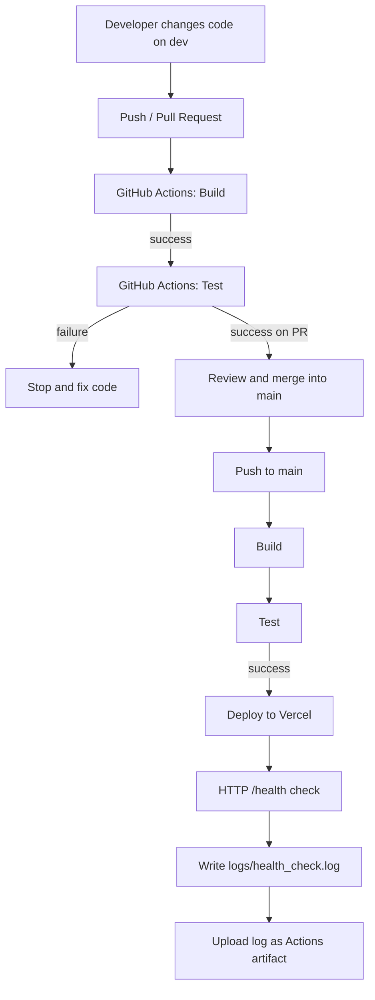
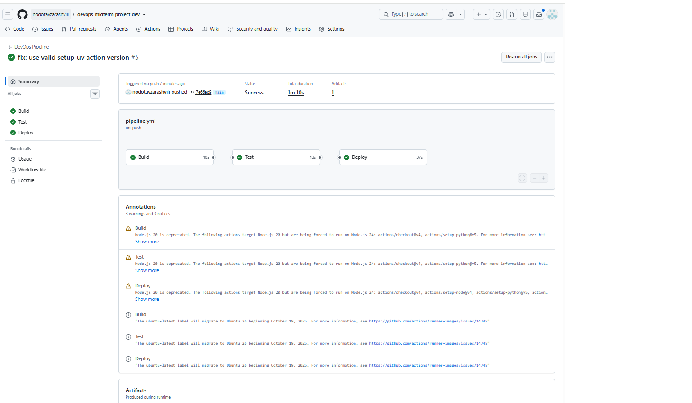
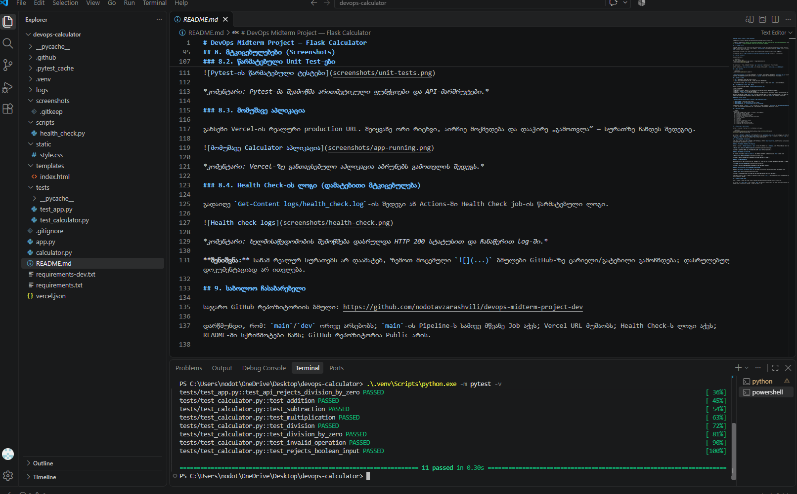
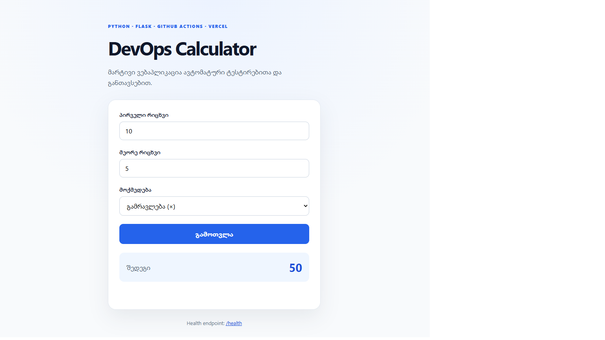
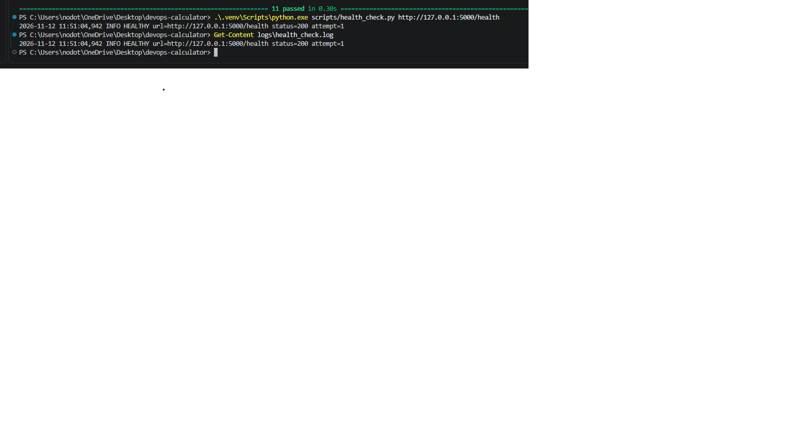

# DevOps Midterm Project — Flask Calculator

**Repository:** https://github.com/nodotavzarashvili/devops-midterm-project-dev

> **Before submission:** Replace the placeholder deployment URL below with the real Vercel URL and add your **own genuine** screenshots to `screenshots/`. Broken screenshot links are not sufficient evidence.

## 1. პროექტის აღწერა

**DevOps Calculator** არის Flask-ის მარტივი ვებაპლიკაცია, რომელიც ასრულებს ოთხ არითმეტიკულ ოპერაციას: მიმატება, გამოკლება, გამრავლება და გაყოფა. შეცდომებს ამოწმებს (მაგ., ნულზე გაყოფა). `calculator.py` შეიცავს ბიზნესლოგიკას, `app.py` — HTTP მარშრუტებს, `templates/index.html` — მომხმარებლის ინტერფეისს.

ტექნოლოგიები: **Python 3.12, Flask, Pytest, Git, GitHub, GitHub Actions, Vercel, Python logging**.

**Production URL:** `https://devops-midterm-calculator.vercel.app/` 

## 2. ლოკალურად გაშვება

Windows PowerShell:

```powershell
py -3.12 -m venv venv
.\venv\Scripts\python.exe -m pip install -r requirements-dev.txt
.\venv\Scripts\python.exe app.py
```

თუ Python 3.12 არ არის, შეგიძლია გამოიყენო `py -m venv venv` (Python 3.12+ რეკომენდებულია).

ბრაუზერში გახსენი `http://127.0.0.1:5000`, ჯანმრთელობის შესამოწმებლად — `http://127.0.0.1:5000/health`.

## 3. Unit Test-ები

```powershell
.\venv\Scripts\python.exe -m pytest -v
```

`tests/test_calculator.py` ამოწმებს მათემატიკურ ოპერაციებს, შეცდომებსა და ვალიდაციას. `tests/test_app.py` ამოწმებს HTTP პასუხებს. ტესტების წარმატებით დასრულება უნდა აჩვენებდეს `11 passed` (ფაქტობრივი შედეგი შეამოწმე ტერმინალში).

## 4. Git და ბრენჩები

- `dev`: ცვლილებები, ტესტირება და Pull Request.
- `main`: შემოწმებული სამუშაო ვერსია, რომელიც Vercel-ზე განთავსდება.

რეკომენდებული პროცესი: `dev` → Push → Build/Test → Pull Request → Merge into `main` → Build/Test/Deploy.

## 5. CI/CD Pipeline — Build, Test, Deploy

GitHub Actions-ის კონფიგურაციაა `.github/workflows/pipeline.yml`.

| Job | მოქმედება |
| --- | --- |
| **Build** | checkout, Python 3.12, dependencies-ის დაყენება, Python ფაილების კომპილაცია |
| **Test** | `pytest -v` — Unit და API ტესტები |
| **Deploy** | მხოლოდ `main`-ზე push-ის შემდეგ Vercel CLI-ით production deployment; შემდგომ Health Check და log artifact |

Workflow ავტომატურად ირთვება `main`/`dev` ბრენჩებზე Push-ისას და ამ ბრენჩებზე Pull Request-ების დროს. PR-ზე და `dev`-ის Push-ზე Deploy ეტაპი მიზანმიმართულად გამოტოვებულია. სამივე წარმატებული job უნდა ჩანდეს **`main`-ზე Push-ის** workflow-ში.

### GitHub Actions secrets

`Settings → Secrets and variables → Actions → New repository secret`:

- `VERCEL_TOKEN` — Vercel-ის Access Token.
- `VERCEL_ORG_ID` — `.vercel/project.json`-ის `orgId`.
- `VERCEL_PROJECT_ID` — `.vercel/project.json`-ის `projectId`.

## 6. Workflow diagram



## 7. Monitoring & Health Check

ლოკალური შემოწმება (აპლიკაცია ამ დროს გაშვებული უნდა იყოს):

```powershell
.\venv\Scripts\python.exe scripts/health_check.py http://127.0.0.1:5000/health
Get-Content logs/health_check.log
```

სკრიპტი წერს `HEALTHY`, `UNHEALTHY`, HTTP სტატუსსა და დროს `logs/health_check.log`-ში. CI-ის Deploy job ამავე სკრიპტს უშვებს Vercel-ის URL-ზე და `.log` ფაილს ტვირთავს `health-check-log` Artifact-ად (Actions → Run → Artifacts). ლოკალური `.log` Git-ში არ იტვირთება, რადგან `.gitignore` იცავს მას; CI-ის არტეფაქტი არის შენახული მტკიცებულება.

## 8. მტკიცებულებები (Screenshots)


### 8.1. წარმატებული სამსაფეხურიანი Pipeline

GitHub → Actions → `DevOps Pipeline` → `main` ბრენჩის წარმატებული run → `Summary`. უნდა ჩანდეს **Build, Test, Deploy** მწვანედ.



*კომენტარი: ყველა ძირითადი Job წარმატებით დასრულდა `main`-ზე Push-ის შემდეგ.*

### 8.2. წარმატებული Unit Test-ები

VS Code-ის ტერმინალში `python -m pytest -v` წარმატებული შედეგი ან GitHub Actions-ის `Test` job-ის ლოგი.



*კომენტარი: Pytest-მა შეამოწმა არითმეტიკული ფუნქციები და API-მარშრუტები.*

### 8.3. მომუშავე აპლიკაცია

გახსენი Vercel-ის რეალური production URL. შეიყვანე ორი რიცხვი, აირჩიე მოქმედება და დააჭირე „გამოთვლა“ — სურათზე ჩანდეს შედეგიც.



*კომენტარი: Vercel-ზე განთავსებული აპლიკაცია აბრუნებს გამოთვლის შედეგს.*

### 8.4. Health Check-ის ლოგი (დამატებითი მტკიცებულება)




*კომენტარი: ხელმისაწვდომობის შემოწმება დასრულდა HTTP 200 სტატუსით და ჩანაწერით log-ში.*


