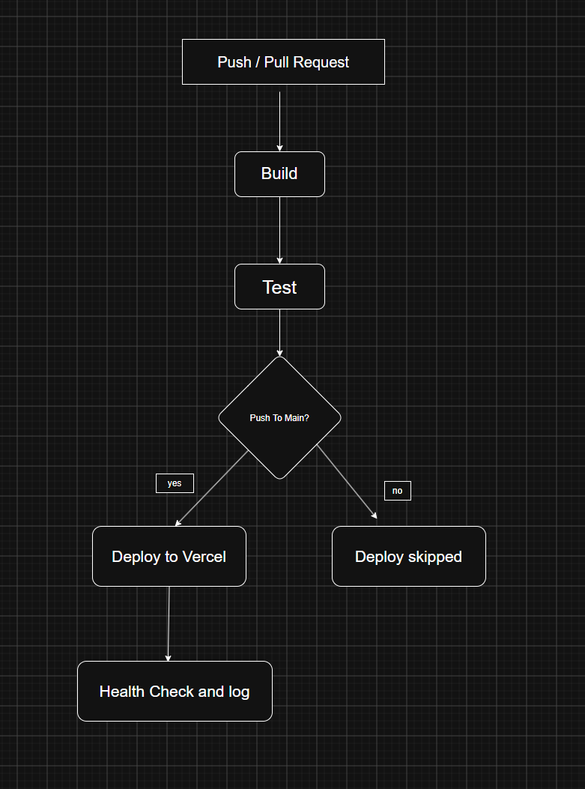
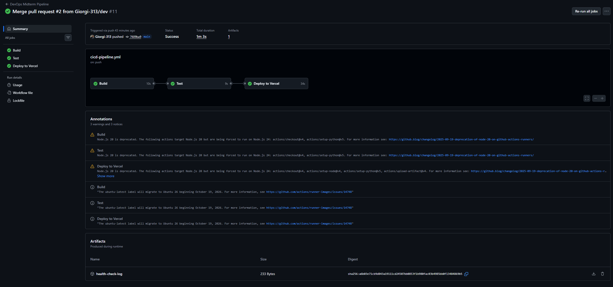
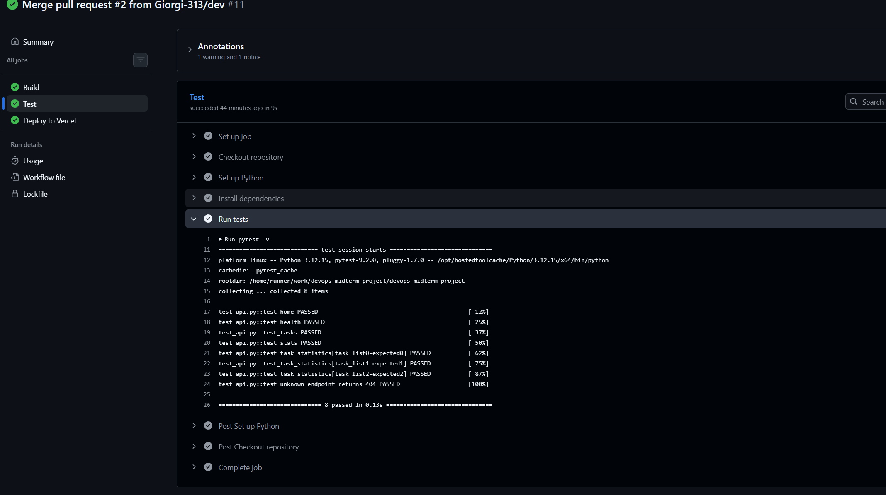
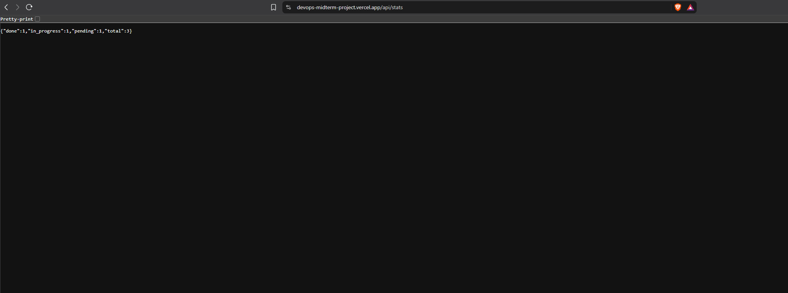

## DevOps Project

ეს არის Flask-ზე გაკეთებული მარტივი დავალებების API.
აქვს დავალებების სია და ფუნქცია, რომელიც ითვლის რამდენი დავალებაა
დასრულებული, მიმდინარე და შესასრულებელი.

დავალებები ინახება Python-ის სიაში. გამოყენებულია Flask, pytest,
GitHub Actions და Vercel.

აპლიკაცია: https://devops-midterm-project.vercel.app

აპლიკაცია აბრუნებს დავალებების სიას, ითვლის მათ სტატისტიკას
და აქვს ჯანმრთელობის შემოწმების მისამართი.

## ტესტები
```
ტესტები იშვება ბრძანებით:
python -m pytest -v
```

სულ არის 8 სატესტო შემთხვევა. მოწმდება აპლიკაციის მისამართები,
მათი პასუხები და არარსებულ მისამართზე დაბრუნებული 404 სტატუსი.

დავალებების დათვლის ფუნქცია ცალკეც იტესტება:
ცარიელი სიით, ორი დასრულებული დავალებით და სხვადასხვა სტატუსის
მქონე დავალებებით. ამისთვის გამოყენებულია pytest.mark.parametrize.

## ბრენჩები და პაიპლაინი

პროექტს აქვს main და dev ბრენჩები.
ცვლილებები კეთდება dev-ზე და Pull Request-ით გადადის main-ში.

პაიპლაინის ფაილია `.github/workflows/cicd-pipeline.yml`.
ის ავტომატურად იშვება main და dev ბრენჩებზე push-ისას
და ამ ბრენჩებზე Pull Request-ის შექმნისა და განახლებისას.

პაიპლაინი შედგება სამი ეტაპისგან:

1. Build აყენებს Python 3.12-ს და საჭირო ბიბლიოთეკებს,
   შემდეგ ამოწმებს Python ფაილების სინტაქსს.
2. Test — უშვებს pytest ტესტებს.
3. Deploy ტვირთავს აპლიკაციას Vercel-ზე, ამოწმებს მის
   მუშაობას და ინახავს შემოწმების ლოგს.

ეტაპები ერთმანეთზეა დამოკიდებული needs პარამეტრით.
თუ Build ან Test ვერ გაივლის, Deploy არ შესრულდება.

Deploy იშვება მხოლოდ main-ზე push-ისას.
ამიტომ dev-ზე და Pull Request-ზე მისი Skipped სტატუსი ნორმალურია.
Pull Request-ის main-ში merge-ის შემდეგ დეპლოიც სრულდება.
Vercel საბოლოო build-ს დეპლოის დროს აკეთებს.

## პროცესის დიაგრამა




## Vercel

დეპლოისთვის GitHub-ის Repository secrets-ში დამატებულია:

- VERCEL_TOKEN
- VERCEL_ORG_ID
- VERCEL_PROJECT_ID

ეს მნიშვნელობები გამოიყენება ავტორიზაციისთვის და შესაბამისი
Vercel პროექტის ასარჩევად. თვითონ მნიშვნელობები კოდში არ წერია.
```თვოთონ json ფაილი დამჭირდა რომ ვერცელზე ყოფილიყო და ბ გზით წავსულიყავი```
vercel.json მიუთითებს app_core.py ფაილს.
Vercel-ის დამოუკიდებელი Git-დეპლოიმენტი გამორთულია,
რადგან დეპლოი GitHub Actions-იდან სრულდება ტესტების გავლის შემდეგ.

## ჯანმრთელობის შემოწმება

შემოწმების ხელით გასაშვებად:

```bash
python health_check.py
```

სკრიპტი ამოწმებს ამ მისამართს:
https://devops-midterm-project.vercel.app/api/health


შედეგი და შემოწმების დრო იწერება uptime_status.log ფაილში.
წარმატებისას სკრიპტი სრულდება კოდით 0, შეცდომისას — კოდით 1.

რეპოზიტორიის მთავარ საქაღალდეში არის ხელით გაშვებული
შემოწმების ლოგი. პაიპლაინში სკრიპტი დეპლოის შემდეგაც იშვება
და მისი ლოგი ინახება Actions-ის Artifacts სექციაში,!!!!!!
სახელით health-check-log.

ლოგის შენახვის ნაბიჯს აქვს if: always(), ამიტომ შემოწმების
შეცდომის შემთხვევაშიც ცდილობს არსებული ლოგის შენახვას.
რეპოზიტორიაში არსებული ლოგი ავტომატურად არ ახლდება.

შემოწმება სრულდება დეპლოის შემდეგ ან ხელით გაშვებისას.
ავტომატური Rollback დამატებული არ არის.

## სქრინშოტები

### პაიპლაინი

main ბრენჩზე სამივე ეტაპი წარმატებით დასრულდა.



### ტესტები

ტესტების გაშვება და რვა წარმატებული შედეგი.



### აპლიკაცია

Vercel-ზე გაშვებული აპლიკაციის სტატისტიკის გვერდი.


